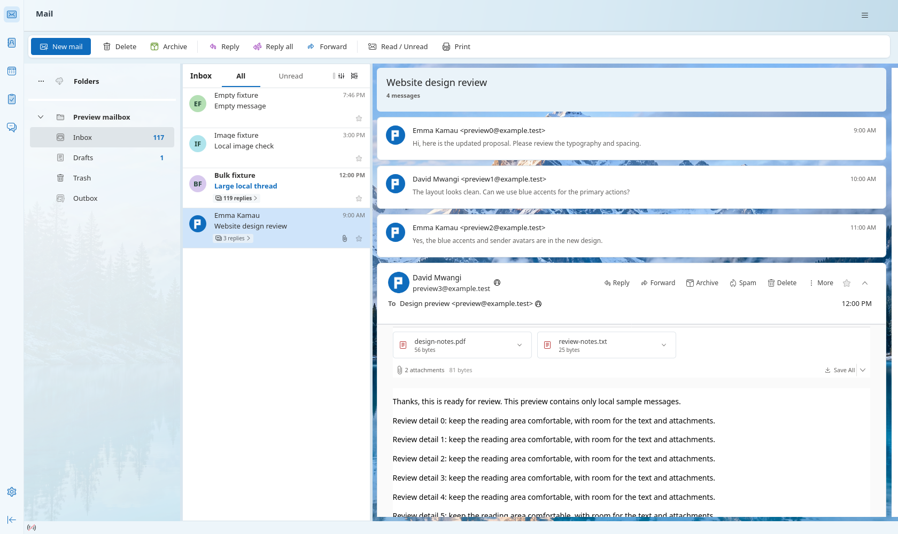

# Outlook Bird

An Outlook-inspired layout for Thunderbird, maintained in this fork. It uses a
local MailExtension and profile stylesheets on the installed Thunderbird binary.
It is not a separately compiled email client or a Microsoft product.



## Supported environment

Linux, Python 3.10+, Thunderbird **159.x**, built-in light theme. Other major
versions are intentionally excluded until their message and compose interfaces
have been tested. Encrypted mail, provider authentication and sending remain
Thunderbird's responsibility; this package does not replace its mail engine.

## Reading and composing

- Light folder pane, mail toolbar, sender initials/photos and All/Unread filters.
- Independent expandable conversation cards with one outer scrollbar.
- Matching font sizes, margins and top attachment cards in single-message views.
- Accessible loading, empty-body and timeout states, with a native reload action.
- Native attachment menus, reply/forward commands and draft handling.
- Compose controls styled for readable subjects and discoverable attachments.
- Visible keyboard focus, system high-contrast focus colours and reduced motion.
- Long threads start with one message browser; others are created on expansion.

Message content stays in Thunderbird's native message browser. Links, MIME
parsing, remote-content policy and attachment opening use Thunderbird handlers.
The layout never automatically opens files, sends mail, downloads profile photos
or uploads mailbox data. Replies and signatures retain native behaviour.

## Install or update

Save drafts and **close Thunderbird**. Extract a release archive or use this
source folder, then run:

```sh
python3 manage.py install
# Later, from the new release folder:
python3 manage.py update
```

The installer checks the installed Thunderbird version, builds and installs the
XPI and stylesheets, and saves a private backup for the selected profile. Start
Thunderbird to load the change. If Thunderbird asks whether to enable the local
add-on, review and enable it. The privileged experiment is needed to modify
native mail controls. There is no background updater or remote installer.

The default profile is found through `profiles.ini`. For a different initialized
profile use `--profile /absolute/path/to/profile`. A non-default Thunderbird
executable can be selected with `--thunderbird /absolute/path/to/thunderbird`.

Remote images retain the profile's existing policy. If you explicitly want all
remote images, including open-tracking pixels, use `--allow-remote-images` with
install/update. Existing explicit choices in an older Outlook Bird settings
block are preserved. New users are not opted in automatically.

## Rollback or uninstall

Close Thunderbird first:

```sh
python3 manage.py rollback  # Restore the version before the latest update.
python3 manage.py restore   # Restore the original appearance.
```

Both actions affect only this package's files and managed preferences. Later
unrelated preferences, window arrangements, account photos and mail files are
preserved. Each profile has independent backups under
`~/.local/state/outlook-bird/`. A failed installation restores its prior snapshot.

Before upgrading Thunderbird to an untested major version, restore the original
appearance. The extension is capped at the tested major version to avoid silently
using incompatible native interfaces.

## Local sender photos

Store an email-to-image mapping in the profile's `chrome/avatars.json`:

```json
{"sender@example.test": "data:image/png;base64,..."}
```

Use lowercase addresses and base64 PNG/JPEG data URIs under 2 MB per entry.
Restart after changing this file. This is private profile configuration; do not
commit account data to the fork. Other senders keep their initials. Local photos
do not modify Microsoft or other provider profile photos.

## Build, verify and package

```sh
python3 -m unittest discover -s tests -p 'test_*.py'
python3 manage.py build
python3 tests/smoke.py --screenshot preview.png
python3 manage.py release
```

The UI runner uses a temporary offline profile with Local Folders, sample mail,
local drafts and a loopback image server. No outgoing server is configured. It
checks single messages, conversations, stalled loads/retry, empty bodies, a
120-message thread, composition, signatures, draft reopening, attachments,
keyboard behaviour, repeated add-on reloads and an application restart.

`release` creates `dist/outlook-bird-<version>.zip` with the installer, XPI,
source, stylesheets and a `SHA256SUMS` file. After extracting on Linux verify:

```sh
sha256sum -c SHA256SUMS
```

GitHub Actions runs installer/build tests and produces an installer artifact on
changes to this package. Real Thunderbird UI tests are run locally on the
supported application; CI does not claim to run them. See [VERIFICATION.md](VERIFICATION.md)
for evidence and limits and [CHANGELOG.md](CHANGELOG.md) for release changes.
